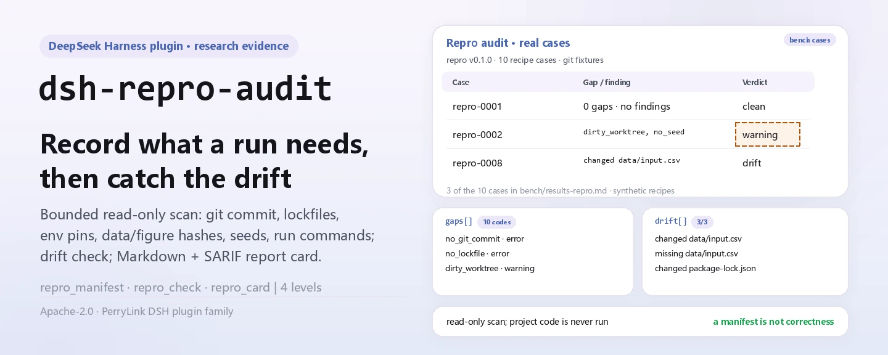
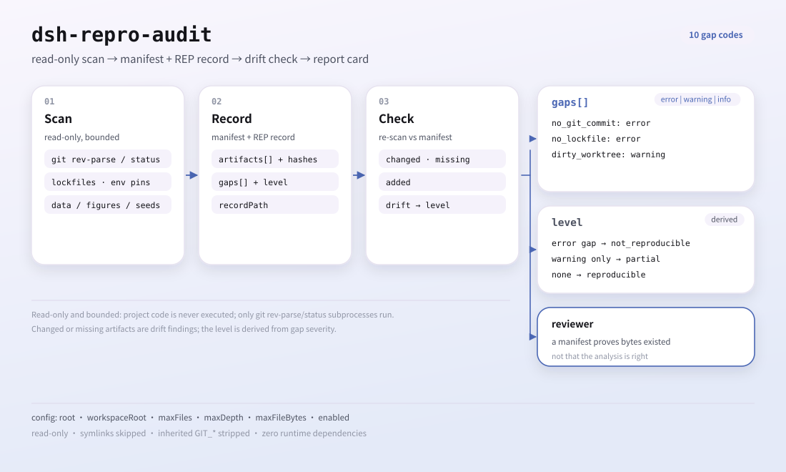
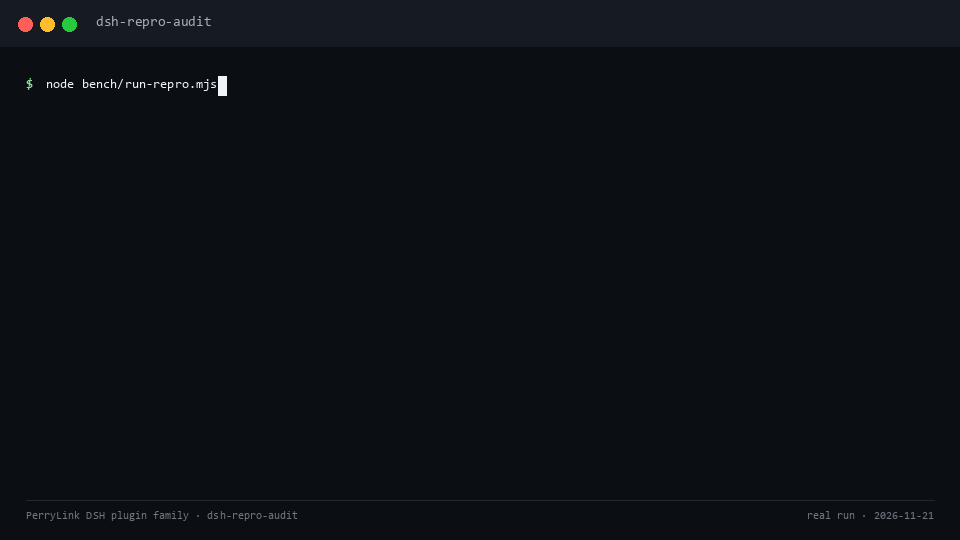

<div align="center">

<picture>
  <source media="(prefers-color-scheme: dark)" srcset="docs/assets/dsh-repro-audit-hero-en-dark.webp">
  
</picture>

# dsh-repro-audit

**¿Podría otra persona reproducir este análisis — y ha cambiado algo desde que lo registraste?**

*Un escaneo acotado y de solo lectura que registra el commit, los lockfiles, el entorno, los hashes de los datos, las figuras, las semillas y los comandos de ejecución; una comprobación de drift contra ese registro; y un informe que puedes entregar a un revisor.*

[English](README.md) · [简体中文](README-zh.md) · [Español](README-es.md) · [Português](README-pt.md) · [हिन्दी](README-hi.md)

[](LICENSE)
[]()

</div>

---

## Qué hace

- **`repro_manifest`** escanea un proyecto del espacio de trabajo y registra: commit de git + estado sucio, lockfiles de dependencias, fijaciones de entorno (`.nvmrc`, `.python-version`, `pyproject.toml`, Dockerfile…), hashes de los datos de entrada, hashes de figuras, notebooks, semillas aleatorias explícitas (`random_state`, `np.random.seed`, `set.seed`, `torch.manual_seed`…) y comandos ejecutables (scripts de package.json, objetivos de Makefile, scripts de entrada `run`/`reproduce`/`analysis`).
- **`repro_check`** vuelve a escanear y compara: un artefacto que **cambió** o **desapareció** es un hallazgo — así se detecta un archivo de datos editado después del manifiesto.
- **`repro_card`** renderiza la evidencia como Markdown + SARIF 2.1.0, con cada hueco, su gravedad y una sugerencia concreta.

Niveles: `reproducible` (sin hueco de error/aviso), `partial` (solo avisos), `not_reproducible` (cualquier hueco de error o drift), `unknown` (reservado).

<picture>
  <source media="(prefers-color-scheme: dark)" srcset="docs/assets/dsh-repro-audit-flow-v5-dark.svg">
  
</picture>

*Estructura: escanear → registrar → comprobar; `gaps[]` y `level` son las dos salidas, y un artefacto cambiado o desaparecido es un hallazgo de drift, no un fallo del análisis. Las etiquetas de token dentro del diagrama son los nombres reales de las herramientas, los códigos de hueco y los campos, así que la misma imagen sirve para los cinco idiomas.*

## Qué no hace

- **Sin ejecución.** El código del proyecto nunca se ejecuta; los únicos subprocesos son `git rev-parse` y `git status`, con timeout y sin shell.
- **Sin subida ni build.** No descarga datos, no instala dependencias ni reproduce figuras.
- **Sin afirmación de verdad.** Un manifiesto prueba que estos bytes existían; no prueba que el análisis sea correcto o completo.
- **Sin UI.** Solo JSON + Markdown + SARIF.

## Códigos de hueco

| Código | Gravedad | Significado |
|---|---|---|
| `no_git_commit` | error | no es un repositorio git, o no hay commit |
| `no_lockfile` | error | no se registró ningún lockfile de dependencias |
| `no_run_command` | error | no se encontró ningún punto de entrada |
| `dirty_worktree` | warning | cambios sin confirmar; el commit no describe los archivos |
| `no_seed` | warning | hay scripts pero no se encontró ninguna semilla literal |
| `no_data` | warning | no hay archivo de datos de entrada en el proyecto |
| `no_environment` | warning | no hay fijación de runtime/entorno |
| `unhashed_data` | warning | un archivo de datos superó el límite de hash |
| `no_figures` | info | sin salida de figuras/tablas |
| `scan_truncated` | warning | se alcanzó el límite de archivos |

Los huecos de error hacen que el nivel sea `not_reproducible`; los avisos lo hacen `partial`.

## Herramientas

### `repro_manifest`

`{ path? }` → `{ ok, manifest, recordPath }`. El registro es un `ResearchRecord` de REP válido cuyos `artifacts` son la evidencia de código/entorno/datos/semillas/comandos/figuras/notebooks.

### `repro_check`

`{ manifest | manifestPath, path? }` → `{ ok, drift }`. `manifestPath` es relativo al espacio de trabajo; `path` es el proyecto a reescanear (por defecto, la raíz del espacio de trabajo).

### `repro_card`

`{ manifest, drift? }` → `{ ok, markdown, sarif }`.

### Códigos de error

`INVALID_INPUT` · `NOT_FOUND` · `PATH_ESCAPE` · `NOT_A_DIRECTORY` · `INVALID_MANIFEST` · `STORE_ERROR`

## Compatibilidad e instalación

| | |
|---|---|
| DeepSeek Harness | **`dsh-v0.2.3-alpha.1`** (verificado 2026-11-22); peer `>=0.2.1-0 <0.3.0 \|\| >=0.2.2-0 <0.3.0` |
| Node | `^22.19.0 \|\| >=24.9.0` (probado en `24.22.1`), solo ESM |
| Peers | `@perrylink/dsh-research-core ^0.1.0`, `@deepseek-ai/cordis ^4.0.5-alpha.1`, `@deepseek-ai/dsh-tools`, `@deepseek-ai/schemastery ^3.18.5-alpha.1` |
| Dependencias en tiempo de ejecución | **cero** |

```sh
dsh plugin --profile <name> add @perrylink/dsh-research-core dsh-repro-audit
dsh --profile <name> --dump-config | grep dsh-repro-audit
```

## Configuración

| Clave | Por defecto | Significado |
|---|---|---|
| `enabled` | `true` | `false` no monta nada |
| `root` | `.repro-audit` | raíz del manifiesto y del registro |
| `workspaceRoot` | `process.cwd()` | las rutas del proyecto deben resolverse dentro de ella |
| `maxFiles` | `2000` | archivos visitados por escaneo (el exceso se informa) |
| `maxDepth` | `6` | profundidad de directorios |
| `maxFileBytes` | `8388608` | límite de hash por archivo (los datos mayores se registran sin hash + hueco) |

Directorios ignorados: `.git`, `node_modules`, `.venv`, `dist`, `build`, `target`, `__pycache__`, `coverage`, `.next`, las cachés, `.repro-audit`, más la raíz del almacén configurada cuando está dentro del proyecto.

## Límites de seguridad

- El proyecto es de solo lectura; los registros van bajo `root`. Un almacén que vive dentro del árbol escaneado (el `.repro-audit/` por defecto) queda excluido del escaneo, así que el manifiesto no puede incluir sus propios registros.
- Los enlaces simbólicos dentro del proyecto se informan y se omiten, nunca se siguen.
- Los límites de hash evitan picos de memoria; el límite de archivos se informa, no se ignora.
- `git` se ejecuta con argumentos fijos de solo lectura, timeout de 5 s y `windowsHide`; sin shell. Los hooks fsmonitor locales del repositorio se desactivan (`-c core.fsmonitor=false`) y `GIT_OPTIONAL_LOCKS=0` evita que `git status` refresque o escriba el índice; las variables `GIT_*` heredadas se eliminan para que `git -C <root>` no pueda redirigirse a otro repositorio.

## Evaluación



*Animado: la stdout real del adaptador del benchmark — un `mkdtemp` nuevo por receta, fixtures git aislados, drift aplicado después del manifiesto, sin red (reejecutado el 2026-11-21).*

**27 pruebas**: escaneo (lockfiles/datos/figuras/semillas/comandos/runtimes, `node_modules` omitido, enlaces simbólicos omitidos pero informados, la configuración del proyecto no se cuenta como datos, scripts `.r` en minúscula, límite de archivos, almacén propio excluido (incluso a través de rutas de espacio de trabajo enlazadas o cortas), hook fsmonitor no ejecutado, `GIT_*` heredadas ignoradas), niveles del manifiesto (limpio → reproducible, sin semilla → partial, sin git → not_reproducible, sucio → partial, conjunto de huecos de un proyecto vacío), drift (datos cambiados + figura desaparecida, reverificación limpia), runtime (registro REP válido, manifiesto en línea, manifiesto guardado con ruta de proyecto, manifiestos guardados malformados rechazados con `INVALID_MANIFEST`, escape a través de un manifiesto enlazado rechazado, escape de ruta), herramientas (esquemas, extremo a extremo manifiesto→check→card, rama de fallo, entrada de card malformada), contrato del paquete.

### Benchmark sintético de reproducibilidad

Un **benchmark sintético determinista de 10 casos** (conjunto de datos `repro` v0.1.0) vive en el repositorio hermano `dsh-research-bench`, bajo `data/repro`; no se incluye en este paquete. Cada caso es una **receta** — un mapa ruta relativa→contenido de archivos, un modo git (`none`, `commit`, `dirty`, `commit-then-modify`) y una operación de drift (`none`, `modify:<path>`, `delete:<path>`). El adaptador materializa la receta en un `mkdtemp` nuevo, registra un manifiesto con `ReproAuditRuntime.manifest`, aplica el drift al árbol y después llama a `ReproAuditRuntime.check`. Los niveles y conjuntos de códigos esperados están escritos a mano a partir de la receta y de las reglas documentadas; el adaptador nunca deriva un valor esperado de la salida del plugin.

Cobertura: 1 proyecto completo limpio; 2 huecos de evidencia (falta semilla, falta lockfile); 2 huecos de runtime (sin comando de ejecución, sin fijación de entorno); 2 huecos de git (sin repositorio, árbol sucio); 3 casos de drift (datos registrados modificados, datos registrados eliminados, lockfile registrado modificado). El fixture sin semilla también lleva una edición rastreada después del commit, así que ejercita dos avisos a la vez. Los cuatro modos de git y los tres modos de drift están representados.

Medido con los comandos de abajo (Node 24.22.1, git 2.43.0):

| Métrica | Resultado |
|---|---:|
| Precisión de nivel (manifiesto, momento del registro) | 10/10 (100%) |
| Precisión / exhaustividad de huecos (micro, conjuntos exactos) | 1.000 / 1.000 |
| Coincidencia exacta del conjunto de huecos | 10/10 |
| Detección de drift (hallazgos no vacíos) | 3/3 |
| Hallazgo de drift exacto (estado + ruta) | 3/3 |
| Sin falsos positivos en casos limpios | 7/7 |
| Casos superados | 10/10 |

```sh
pnpm run build
pnpm run bench:repro        # lee ../dsh-research-bench/data/repro (BENCH_DIR / --data lo sobrescriben)
```

Escribe `bench/results-repro.json` y `bench/results-repro.md` (sin marcas de tiempo; volver a ejecutarlo sobre el mismo conjunto es idéntico byte a byte). Git es un requisito duro: el adaptador termina con código 2 si `git` no está en `PATH`. Los repositorios de fixture usan la identidad fija `fixture@example.invalid`, una configuración git global vacía y un almacén temporal fuera del proyecto, así que la configuración git del host y el almacén registrado no pueden cambiar las etiquetas.

Matriz de escenarios de las pruebas unitarias (los mismos escenarios también están cubiertos por las pruebas unitarias):

| Escenario | Esperado | Cubierto |
|---|---|---|
| proyecto completo, árbol limpio | `reproducible`, 0 huecos | test + benchmark |
| sin semilla | `partial`, `no_seed` | test + benchmark |
| sin git | `not_reproducible`, `no_git_commit` | test + benchmark |
| cambio sin confirmar | `partial`, `dirty_worktree` | test + benchmark |
| datos editados tras el manifiesto | drift `changed`, `not_reproducible` | test + benchmark |
| figura eliminada | drift `missing` | test |
| datos eliminados tras el manifiesto | drift `missing`, `not_reproducible` | benchmark |
| lockfile editado tras el manifiesto | drift `changed`, `not_reproducible` | benchmark |
| manifiesto recién registrado | drift vacío | test + benchmark |

## Limitaciones conocidas (v0.1)

- Solo a nivel de metadatos: no verifica que el comando registrado reproduzca realmente las figuras.
- Las semillas se encuentran por patrones literales; las semillas inyectadas vía archivos de configuración o variables de entorno se pierden.
- Las figuras se hashean pero no se ligan al script que las produjo (aún no hay grafo de procedencia).
- Los archivos de datos grandes se registran sin hash (con un hueco) en lugar de procesarse en streaming.
- Sin conocimiento de `.gitignore`: los archivos ignorados pero presentes se hashean igualmente si son de datos/figuras/extensiones correspondientes.
- El benchmark de reproducibilidad es sintético y pequeño (10 recetas): mide las reglas de huecos y drift a nivel de escáner, no la reproducibilidad del mundo real. Una puntuación de 1.0 es una línea base de regresión, no una estimación insesgada de la precisión en repositorios reales.
- El benchmark necesita `git`; en una máquina sin él, `bench:repro` termina con código 2 y no escribe resultados.

## Licencia

Apache-2.0. Sin código de terceros en tiempo de ejecución.
