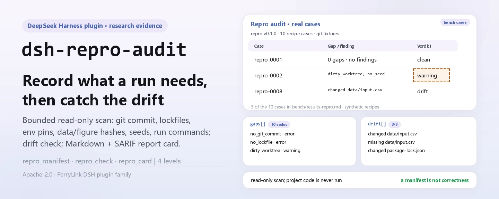
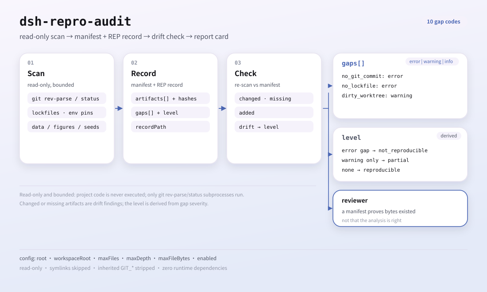
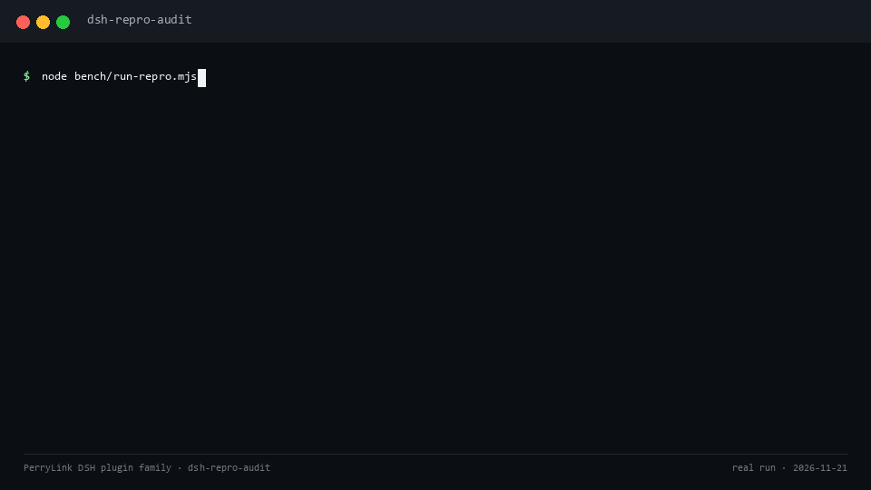

<div align="center">

<picture>
  <source media="(prefers-color-scheme: dark)" srcset="docs/assets/dsh-repro-audit-hero-en-dark.webp">
  
</picture>

# dsh-repro-audit

**क्या कोई और इस विश्लेषण को दोबारा बना सकेगा — और जब से आपने इसे दर्ज किया, कुछ बदला है?**

*एक सीमित, केवल-पढ़ने वाली स्कैन जो commit, lockfile, पर्यावरण, डेटा हैश, चित्र, seed और चलाने योग्य कमांड दर्ज करती है; उस रिकॉर्ड के विरुद्ध drift जाँच; और एक रिपोर्ट जो आप समीक्षक को दे सकें।*

[English](README.md) · [简体中文](README-zh.md) · [Español](README-es.md) · [Português](README-pt.md) · [हिन्दी](README-hi.md)

[](LICENSE)
[]()

</div>

---

## यह क्या करता है

- **`repro_manifest`** वर्कस्पेस के किसी प्रोजेक्ट को स्कैन करके दर्ज करता है: git commit + गंदी स्थिति, निर्भरता lockfile, पर्यावरण पिन (`.nvmrc`, `.python-version`, `pyproject.toml`, Dockerfile…), इनपुट-डेटा हैश, चित्र हैश, notebook, स्पष्ट यादृच्छिक seed (`random_state`, `np.random.seed`, `set.seed`, `torch.manual_seed`…) और चलाने योग्य कमांड (package.json scripts, Makefile targets, `run`/`reproduce`/`analysis` एंट्री स्क्रिप्ट)।
- **`repro_check`** फिर से स्कैन करके तुलना करता है: जो artifact **बदला** या **गायब हो गया** वह एक निष्कर्ष है — इसलिए manifest के बाद संपादित डेटा फ़ाइल भी पकड़ी जाती है।
- **`repro_card`** एविडेंस को Markdown + SARIF 2.1.0 के रूप में रेंडर करता है, हर lacuna, उसकी गंभीरता और ठोस सुझाव के साथ।

स्तर: `reproducible` (कोई error/warning lacuna नहीं), `partial` (केवल warning), `not_reproducible` (कोई error lacuna या drift), `unknown` (आरक्षित)।

<picture>
  <source media="(prefers-color-scheme: dark)" srcset="docs/assets/dsh-repro-audit-flow-v5-dark.svg">
  
</picture>

*संरचना: स्कैन → दर्ज → जाँच; `gaps[]` और `level` दो आउटपुट हैं, और बदला या गायब artifact drift निष्कर्ष है, विश्लेषण की विफलता नहीं। डायग्राम के अंदर टोकन लेबल असली टूल, lacuna कोड और फ़ील्ड नाम हैं, इसलिए एक ही चित्र पाँचों भाषाओं के लिए काम आता है।*

## यह क्या नहीं करता

- **कोई निष्पादन नहीं।** प्रोजेक्ट कोड कभी नहीं चलाया जाता; एकमात्र सबप्रोसेस `git rev-parse` और `git status` हैं, timeout के साथ और बिना shell।
- **कोई अपलोड नहीं, कोई build नहीं।** यह डेटा नहीं लाता, निर्भरताएँ स्थापित नहीं करता और चित्र नहीं बनाता।
- **सत्य का दावा नहीं।** manifest साबित करता है कि ये बाइट्स मौजूद थे; यह नहीं कि विश्लेषण सही या पूर्ण है।
- **कोई UI नहीं।** केवल JSON + Markdown + SARIF।

## Lacuna कोड

| कोड | गंभीरता | अर्थ |
|---|---|---|
| `no_git_commit` | error | git रिपॉज़िटरी नहीं है, या कोई commit नहीं |
| `no_lockfile` | error | कोई निर्भरता lockfile दर्ज नहीं |
| `no_run_command` | error | कोई एंट्री पॉइंट नहीं मिला |
| `dirty_worktree` | warning | बिना commit किए बदलाव; commit फ़ाइलों का वर्णन नहीं करता |
| `no_seed` | warning | स्क्रिप्ट मौजूद हैं पर कोई शाब्दिक seed नहीं मिला |
| `no_data` | warning | प्रोजेक्ट में कोई इनपुट डेटा फ़ाइल नहीं |
| `no_environment` | warning | कोई runtime/पर्यावरण पिन नहीं |
| `unhashed_data` | warning | कोई डेटा फ़ाइल हैश सीमा से बड़ी थी |
| `no_figures` | info | कोई चित्र/तालिका आउटपुट नहीं |
| `scan_truncated` | warning | फ़ाइल सीमा पूरी हो गई |

error lacuna स्तर को `not_reproducible` बनाते हैं; warning उसे `partial` बनाते हैं।

## टूल

### `repro_manifest`

`{ path? }` → `{ ok, manifest, recordPath }`. रिकॉर्ड एक वैध REP `ResearchRecord` है जिसके `artifacts` कोड/पर्यावरण/डेटा/seed/कमांड/चित्र/notebook एविडेंस हैं।

### `repro_check`

`{ manifest | manifestPath, path? }` → `{ ok, drift }`. `manifestPath` वर्कस्पेस के सापेक्ष है; `path` वह प्रोजेक्ट है जिसे दोबारा स्कैन करना है (डिफ़ॉल्ट: वर्कस्पेस रूट)।

### `repro_card`

`{ manifest, drift? }` → `{ ok, markdown, sarif }`.

### त्रुटि कोड

`INVALID_INPUT` · `NOT_FOUND` · `PATH_ESCAPE` · `NOT_A_DIRECTORY` · `INVALID_MANIFEST` · `STORE_ERROR`

## अनुकूलता और इंस्टॉल

| | |
|---|---|
| DeepSeek Harness | **`dsh-v0.2.3-alpha.1`** (2026-11-22 को सत्यापित); peer `>=0.2.1-0 <0.3.0 \|\| >=0.2.2-0 <0.3.0` |
| Node | `^22.19.0 \|\| >=24.9.0` (`24.22.1` पर परीक्षित), केवल ESM |
| Peers | `@perrylink/dsh-research-core ^0.1.0`, `@deepseek-ai/cordis ^4.0.5-alpha.1`, `@deepseek-ai/dsh-tools`, `@deepseek-ai/schemastery ^3.18.5-alpha.1` |
| रनटाइम निर्भरताएँ | **शून्य** |

```sh
dsh plugin --profile <name> add @perrylink/dsh-research-core dsh-repro-audit
dsh --profile <name> --dump-config | grep dsh-repro-audit
```

## कॉन्फ़िगरेशन

| कुंजी | डिफ़ॉल्ट | अर्थ |
|---|---|---|
| `enabled` | `true` | `false` पर कुछ भी माउंट नहीं होता |
| `root` | `.repro-audit` | manifest और रिकॉर्ड की जड़ |
| `workspaceRoot` | `process.cwd()` | प्रोजेक्ट पथ इसके अंदर हल होने चाहिए |
| `maxFiles` | `2000` | प्रति स्कैन देखी गई फ़ाइलें (सीमा से अधिक रिपोर्ट होती है) |
| `maxDepth` | `6` | निर्देशिका गहराई |
| `maxFileBytes` | `8388608` | प्रति फ़ाइल हैश सीमा (बड़ा डेटा बिना हैश + lacuna दर्ज होता है) |

अनदेखे निर्देशिकाएँ: `.git`, `node_modules`, `.venv`, `dist`, `build`, `target`, `__pycache__`, `coverage`, `.next`, caches, `.repro-audit`, तथा कॉन्फ़िगर किया गया स्टोर रूट जब वह प्रोजेक्ट के अंदर हो।

## सुरक्षा सीमाएँ

- प्रोजेक्ट केवल-पढ़ने योग्य है; रिकॉर्ड `root` के नीचे जाते हैं। स्कैन किए गए पेड़ के अंदर रहने वाला स्टोर (डिफ़ॉल्ट `.repro-audit/`) स्कैन से बाहर रखा जाता है, इसलिए manifest अपने ही रिकॉर्ड शामिल नहीं कर सकता।
- प्रोजेक्ट के अंदर सिमलिंक रिपोर्ट किए जाते हैं और छोड़ दिए जाते हैं, कभी फ़ॉलो नहीं किए जाते।
- हैश सीमाएँ मेमोरी उछाल रोकती हैं; फ़ाइल सीमा रिपोर्ट होती है, अनदेखी नहीं।
- `git` निश्चित केवल-पढ़ने वाले आर्ग्युमेंट, 5 s timeout और `windowsHide` के साथ चलता है; कोई shell नहीं। रिपॉज़िटरी-स्थानीय fsmonitor hooks बंद रहते हैं (`-c core.fsmonitor=false`) और `GIT_OPTIONAL_LOCKS=0` `git status` को इंडेक्स रिफ़्रेश/लिखने से रोकता है; विरासत में मिले `GIT_*` वेरिएबल हटा दिए जाते हैं ताकि `git -C <root>` किसी दूसरी रिपॉज़िटरी की ओर न मोड़ा जा सके।

## मूल्यांकन



*एनिमेटेड: बेंचमार्क एडाप्टर का असली stdout — प्रति रेसिपी एक नया `mkdtemp`, अलग git फ़िक्सचर, manifest के बाद drift लागू, कोई नेटवर्क नहीं (2026-11-21 को दोबारा चलाया गया)।*

**27 टेस्ट**: स्कैनिंग (lockfile/डेटा/चित्र/seed/कमांड/runtime, `node_modules` छोड़ा गया, सिमलिंक छोड़े गए पर रिपोर्ट किए गए, प्रोजेक्ट कॉन्फ़िग डेटा नहीं गिना गया, छोटे अक्षर वाली `.r` स्क्रिप्ट, फ़ाइल सीमा, अपना स्टोर बाहर (सिमलिंक/छोटे वर्कस्पेस पथों से भी), fsmonitor hook नहीं चला, विरासत में मिले `GIT_*` अनदेखे), manifest स्तर (साफ़ → reproducible, seed नहीं → partial, git नहीं → not_reproducible, गंदा → partial, खाली प्रोजेक्ट का lacuna-समूह), drift (बदला डेटा + गायब चित्र, साफ़ पुनर्जाँच), runtime (वैध REP रिकॉर्ड, इनलाइन manifest, प्रोजेक्ट पथ के साथ सहेजा manifest, विकृत सहेजे manifest `INVALID_MANIFEST` के साथ अस्वीकृत, सिमलिंक manifest से भागना अस्वीकृत, पथ भागना), टूल (स्कीमा, manifest→check→card एंड-टू-एंड, विफलता शाखा, विकृत card इनपुट), पैकेज अनुबंध।

### सिंथेटिक पुनरुत्पादन-क्षमता बेंचमार्क

**10 केसों का नियतात्मक सिंथेटिक बेंचमार्क** (डेटासेट `repro` v0.1.0) सहोदर रिपॉज़िटरी `dsh-research-bench` में `data/repro` के अंतर्गत है; इसे इस पैकेज में शामिल नहीं किया गया। हर केस एक **रेसिपी** है — सापेक्ष-पथ→फ़ाइल-सामग्री का नक्शा, एक git मोड (`none`, `commit`, `dirty`, `commit-then-modify`) और एक drift क्रिया (`none`, `modify:<path>`, `delete:<path>`)। एडाप्टर रेसिपी को एक नए `mkdtemp` में बनाता है, `ReproAuditRuntime.manifest` से manifest दर्ज करता है, पेड़ पर drift लागू करता है और फिर `ReproAuditRuntime.check` कॉल करता है। अपेक्षित स्तर और lacuna-कोड समुच्चय रेसिपी और दस्तावेज़ीकृत lacuna नियमों से हाथ से लिखे गए हैं; एडाप्टर कभी प्लगइन आउटपुट से अपेक्षित मान नहीं निकालता।

कवरेज: 1 पूर्ण साफ़ प्रोजेक्ट; 2 एविडेंस lacuna (seed नहीं, lockfile नहीं); 2 runtime lacuna (कोई रन कमांड नहीं, कोई env पिन नहीं); 2 git lacuna (रिपॉज़िटरी नहीं, गंदा वर्कट्री); 3 drift केस (दर्ज डेटा बदला, दर्ज डेटा हटाया, दर्ज lockfile बदला)। बिना-seed वाले फ़िक्सचर में commit के बाद एक ट्रैक किया गया संपादन भी है, इसलिए वह एक साथ दो warning चलाता है। चारों git मोड और तीनों drift मोड शामिल हैं।

नीचे दिए कमांडों से मापा गया (Node 24.22.1, git 2.43.0):

| मीट्रिक | परिणाम |
|---|---:|
| स्तर सटीकता (manifest, रिकॉर्ड समय) | 10/10 (100%) |
| lacuna precision / recall (micro, सटीक कोड समुच्चय) | 1.000 / 1.000 |
| सटीक lacuna-समुच्चय मिलान | 10/10 |
| drift पहचान (निष्कर्ष खाली नहीं) | 3/3 |
| सटीक drift निष्कर्ष (status + path) | 3/3 |
| साफ़ केसों पर कोई झूठा सकारात्मक नहीं | 7/7 |
| पास हुए केस | 10/10 |

```sh
pnpm run build
pnpm run bench:repro        # ../dsh-research-bench/data/repro पढ़ता है (BENCH_DIR / --data ओवरराइड करते हैं)
```

यह `bench/results-repro.json` और `bench/results-repro.md` लिखता है (कोई टाइमस्टैम्प नहीं; उसी डेटासेट पर दोबारा चलाने पर बाइट-दर-बाइट समान)। git एक कठोर पूर्वशर्त है: `PATH` पर `git` न हो तो एडाप्टर कोड 2 के साथ बाहर निकलता है। फ़िक्सचर रिपॉज़िटरी निश्चित पहचान `fixture@example.invalid`, खाली वैश्विक git कॉन्फ़िग और प्रोजेक्ट के बाहर अस्थायी स्टोर का उपयोग करती हैं, इसलिए होस्ट की git सेटिंग्स और दर्ज स्टोर लेबल नहीं बदल सकते।

यूनिट-टेस्ट परिदृश्य मैट्रिक्स (वही परिदृश्य यूनिट टेस्ट में भी शामिल हैं):

| परिदृश्य | अपेक्षित | कवर |
|---|---|---|
| पूर्ण प्रोजेक्ट, साफ़ पेड़ | `reproducible`, 0 lacuna | test + benchmark |
| seed नहीं | `partial`, `no_seed` | test + benchmark |
| git नहीं | `not_reproducible`, `no_git_commit` | test + benchmark |
| बिना commit किया बदलाव | `partial`, `dirty_worktree` | test + benchmark |
| manifest के बाद डेटा संपादित | drift `changed`, `not_reproducible` | test + benchmark |
| चित्र हटाया गया | drift `missing` | test |
| manifest के बाद डेटा हटाया | drift `missing`, `not_reproducible` | benchmark |
| manifest के बाद lockfile संपादित | drift `changed`, `not_reproducible` | benchmark |
| अभी दर्ज किया manifest | drift खाली | test + benchmark |

## ज्ञात सीमाएँ (v0.1)

- केवल मेटाडेटा स्तर: यह सत्यापित नहीं करता कि दर्ज किया गया कमांड वास्तव में चित्र दोबारा बनाता है।
- seed शाब्दिक पैटर्न से मिलते हैं; कॉन्फ़िग फ़ाइलों या पर्यावरण वेरिएबल से इंजेक्ट किए गए seed छूट जाते हैं।
- चित्र हैश होते हैं पर उन्हें बनाने वाली स्क्रिप्ट से नहीं जोड़ा जाता (अभी कोई provenance ग्राफ़ नहीं)।
- बड़ी डेटा फ़ाइलें स्ट्रीमिंग के बजाय बिना हैश (lacuna के साथ) दर्ज होती हैं।
- `.gitignore` की जानकारी नहीं: अनदेखी की गई पर मौजूद फ़ाइलें भी हैश होती हैं यदि वे डेटा/चित्र/संबंधित एक्सटेंशन की हों।
- पुनरुत्पादन बेंचमार्क सिंथेटिक और छोटा है (10 रेसिपी): यह स्कैनर-स्तरीय lacuna और drift नियम मापता है, असली दुनिया की पुनरुत्पादन-क्षमता नहीं। 1.0 स्कोर एक रिग्रेशन बेसलाइन है, असली रिपॉज़िटरी पर सटीकता का निष्पक्ष अनुमान नहीं।
- बेंचमार्क के लिए `git` ज़रूरी है; बिना `git` वाली मशीन पर `bench:repro` कोड 2 के साथ बाहर निकलता है और कोई परिणाम नहीं लिखता।

## लाइसेंस

Apache-2.0. रनटाइम पर कोई तृतीय-पक्ष कोड नहीं।
