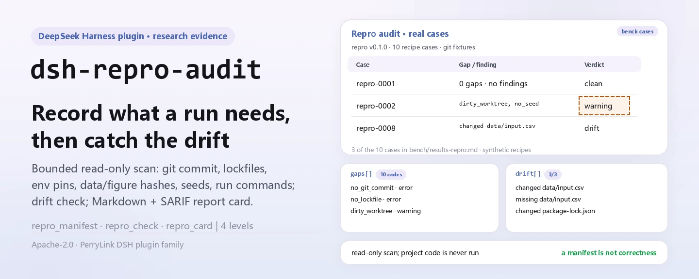
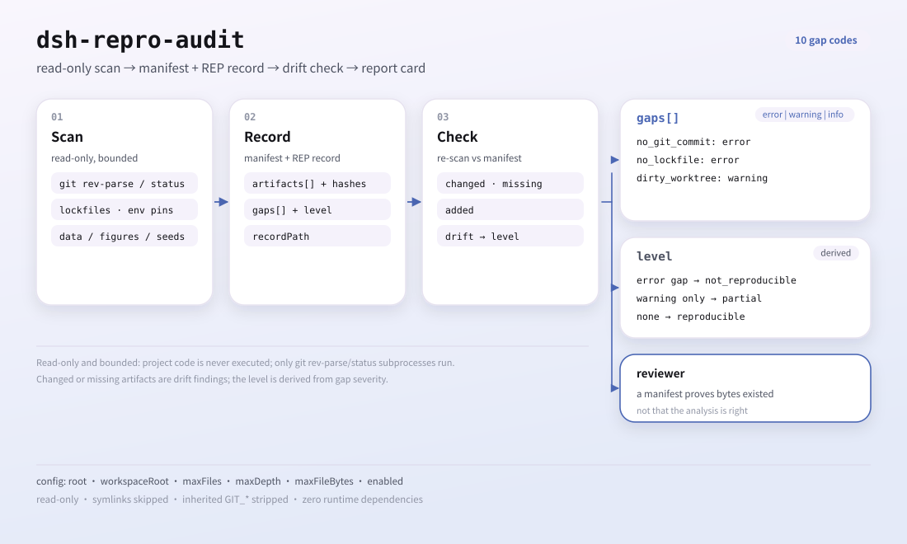
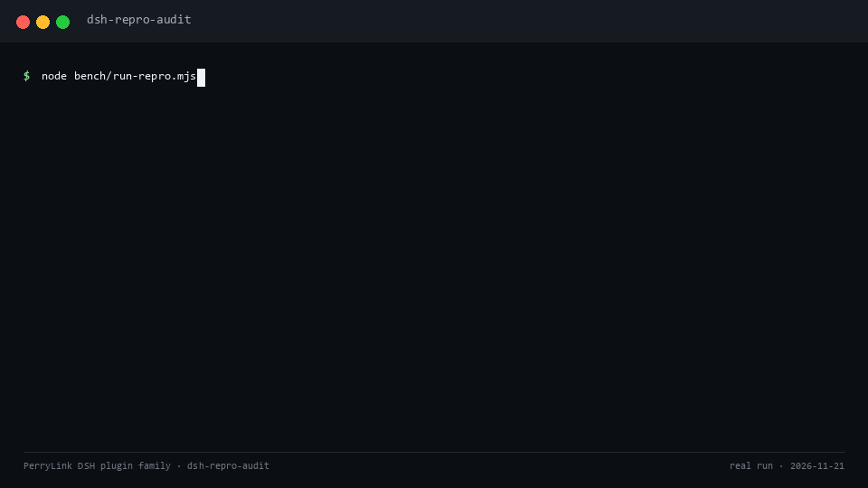

<div align="center">

<picture>
  <source media="(prefers-color-scheme: dark)" srcset="docs/assets/dsh-repro-audit-hero-en-dark.webp">
  
</picture>

# dsh-repro-audit

**Outra pessoa conseguiria reproduzir esta análise — e algo mudou desde que você a registrou?**

*Uma varredura limitada e somente leitura que registra o commit, os lockfiles, o ambiente, os hashes dos dados, as figuras, as sementes e os comandos de execução; uma verificação de drift contra esse registro; e um relatório que você pode entregar a um revisor.*

[English](README.md) · [简体中文](README-zh.md) · [Español](README-es.md) · [Português](README-pt.md) · [हिन्दी](README-hi.md)

[](LICENSE)
[]()

</div>

---

## O que faz

- **`repro_manifest`** varre um projeto do espaço de trabalho e registra: commit do git + estado sujo, lockfiles de dependências, fixações de ambiente (`.nvmrc`, `.python-version`, `pyproject.toml`, Dockerfile…), hashes dos dados de entrada, hashes de figuras, notebooks, sementes aleatórias explícitas (`random_state`, `np.random.seed`, `set.seed`, `torch.manual_seed`…) e comandos executáveis (scripts do package.json, alvos do Makefile, scripts de entrada `run`/`reproduce`/`analysis`).
- **`repro_check`** varre de novo e compara: um artefato que **mudou** ou **desapareceu** é um achado — assim, um arquivo de dados editado depois do manifesto é pego.
- **`repro_card`** renderiza a evidência como Markdown + SARIF 2.1.0, com cada lacuna, sua gravidade e uma sugestão concreta.

Níveis: `reproducible` (sem lacuna de erro/aviso), `partial` (apenas avisos), `not_reproducible` (qualquer lacuna de erro ou drift), `unknown` (reservado).

<picture>
  <source media="(prefers-color-scheme: dark)" srcset="docs/assets/dsh-repro-audit-flow-v5-dark.svg">
  
</picture>

*Estrutura: varrer → registrar → verificar; `gaps[]` e `level` são as duas saídas, e um artefato alterado ou ausente é um achado de drift, não uma falha da análise. Os rótulos de token dentro do diagrama são os nomes reais das ferramentas, dos códigos de lacuna e dos campos, então a mesma imagem serve aos cinco idiomas.*

## O que não faz

- **Sem execução.** O código do projeto nunca é executado; os únicos subprocessos são `git rev-parse` e `git status`, com timeout e sem shell.
- **Sem upload, sem build.** Não baixa dados, não instala dependências nem reproduz figuras.
- **Sem alegação de verdade.** Um manifesto prova que esses bytes existiam; não prova que a análise esteja correta ou completa.
- **Sem UI.** Apenas JSON + Markdown + SARIF.

## Códigos de lacuna

| Código | Gravidade | Significado |
|---|---|---|
| `no_git_commit` | error | não é um repositório git, ou não há commit |
| `no_lockfile` | error | nenhum lockfile de dependências registrado |
| `no_run_command` | error | nenhum ponto de entrada encontrado |
| `dirty_worktree` | warning | mudanças não commitadas; o commit não descreve os arquivos |
| `no_seed` | warning | existem scripts, mas nenhuma semente literal foi encontrada |
| `no_data` | warning | nenhum arquivo de dados de entrada no projeto |
| `no_environment` | warning | nenhuma fixação de runtime/ambiente |
| `unhashed_data` | warning | um arquivo de dados passou do limite de hash |
| `no_figures` | info | sem saída de figuras/tabelas |
| `scan_truncated` | warning | o limite de arquivos foi atingido |

Lacunas de erro tornam o nível `not_reproducible`; avisos o tornam `partial`.

## Ferramentas

### `repro_manifest`

`{ path? }` → `{ ok, manifest, recordPath }`. O registro é um `ResearchRecord` de REP válido cujos `artifacts` são a evidência de código/ambiente/dados/sementes/comandos/figuras/notebooks.

### `repro_check`

`{ manifest | manifestPath, path? }` → `{ ok, drift }`. `manifestPath` é relativo ao espaço de trabalho; `path` é o projeto a ser varrido de novo (padrão: a raiz do espaço de trabalho).

### `repro_card`

`{ manifest, drift? }` → `{ ok, markdown, sarif }`.

### Códigos de erro

`INVALID_INPUT` · `NOT_FOUND` · `PATH_ESCAPE` · `NOT_A_DIRECTORY` · `INVALID_MANIFEST` · `STORE_ERROR`

## Compatibilidade e instalação

| | |
|---|---|
| DeepSeek Harness | **`dsh-v0.2.3-alpha.1`** (verificado em 2026-11-22); peer `>=0.2.1-0 <0.3.0 \|\| >=0.2.2-0 <0.3.0` |
| Node | `^22.19.0 \|\| >=24.9.0` (testado em `24.22.1`), somente ESM |
| Peers | `@perrylink/dsh-research-core ^0.1.0`, `@deepseek-ai/cordis ^4.0.5-alpha.1`, `@deepseek-ai/dsh-tools`, `@deepseek-ai/schemastery ^3.18.5-alpha.1` |
| Dependências de runtime | **zero** |

```sh
dsh plugin --profile <name> add @perrylink/dsh-research-core dsh-repro-audit
dsh --profile <name> --dump-config | grep dsh-repro-audit
```

## Configuração

| Chave | Padrão | Significado |
|---|---|---|
| `enabled` | `true` | `false` não monta nada |
| `root` | `.repro-audit` | raiz do manifesto e do registro |
| `workspaceRoot` | `process.cwd()` | os caminhos do projeto precisam resolver dentro dele |
| `maxFiles` | `2000` | arquivos visitados por varredura (o excesso é reportado) |
| `maxDepth` | `6` | profundidade de diretórios |
| `maxFileBytes` | `8388608` | limite de hash por arquivo (dados maiores são registrados sem hash + lacuna) |

Diretórios ignorados: `.git`, `node_modules`, `.venv`, `dist`, `build`, `target`, `__pycache__`, `coverage`, `.next`, caches, `.repro-audit`, além da raiz de armazenamento configurada quando está dentro do projeto.

## Limites de segurança

- O projeto é somente leitura; os registros vão para `root`. Um armazenamento que vive dentro da árvore varrida (o `.repro-audit/` padrão) é excluído da varredura, então o manifesto não pode incluir seus próprios registros.
- Links simbólicos dentro do projeto são reportados e ignorados, nunca seguidos.
- Limites de hash evitam picos de memória; o limite de arquivos é reportado, não ignorado.
- O `git` roda com argumentos fixos de somente leitura, timeout de 5 s e `windowsHide`; sem shell. Ganchos fsmonitor locais do repositório são desativados (`-c core.fsmonitor=false`) e `GIT_OPTIONAL_LOCKS=0` impede que `git status` atualize/escreva o índice; variáveis `GIT_*` herdadas são removidas para que `git -C <root>` não possa ser redirecionado para outro repositório.

## Avaliação



*Animado: a stdout real do adaptador do benchmark — um `mkdtemp` novo por receita, fixtures git isolados, drift aplicado depois do manifesto, sem rede (reexecutado em 2026-11-21).*

**27 testes**: varredura (lockfiles/dados/figuras/sementes/comandos/runtimes, `node_modules` ignorado, links simbólicos ignorados mas reportados, configuração do projeto não conta como dados, scripts `.r` em minúsculas, limite de arquivos, armazenamento próprio excluído (inclusive por caminhos de espaço de trabalho linkados/curtos), gancho fsmonitor não executado, `GIT_*` herdadas ignoradas), níveis do manifesto (limpo → reproducible, sem semente → partial, sem git → not_reproducible, sujo → partial, conjunto de lacunas de projeto vazio), drift (dados alterados + figura ausente, reverificação limpa), runtime (registro REP válido, manifesto inline, manifesto salvo com caminho do projeto, manifestos salvos malformados rejeitados com `INVALID_MANIFEST`, escape por manifesto linkado rejeitado, escape de caminho), ferramentas (esquemas, ponta a ponta manifesto→check→card, ramo de falha, entrada de card malformada), contrato do pacote.

### Benchmark sintético de reprodutibilidade

Um **benchmark sintético determinístico de 10 casos** (conjunto de dados `repro` v0.1.0) vive no repositório irmão `dsh-research-bench`, em `data/repro`; não é vendorizado neste pacote. Cada caso é uma **receita** — um mapa caminho relativo→conteúdo de arquivos, um modo git (`none`, `commit`, `dirty`, `commit-then-modify`) e uma operação de drift (`none`, `modify:<path>`, `delete:<path>`). O adaptador materializa a receita em um `mkdtemp` novo, registra um manifesto com `ReproAuditRuntime.manifest`, aplica o drift na árvore e então chama `ReproAuditRuntime.check`. Os níveis e conjuntos de códigos esperados são escritos à mão a partir da receita e das regras documentadas; o adaptador nunca deriva um valor esperado da saída do plugin.

Cobertura: 1 projeto completo limpo; 2 lacunas de evidência (falta semente, falta lockfile); 2 lacunas de runtime (sem comando de execução, sem fixação de ambiente); 2 lacunas de git (sem repositório, árvore suja); 3 casos de drift (dados registrados alterados, dados registrados removidos, lockfile registrado alterado). O fixture sem semente também traz uma edição rastreada depois do commit, então exercita dois avisos ao mesmo tempo. Os quatro modos de git e os três modos de drift estão representados.

Medido com os comandos abaixo (Node 24.22.1, git 2.43.0):

| Métrica | Resultado |
|---|---:|
| Precisão de nível (manifesto, momento do registro) | 10/10 (100%) |
| Precisão / recall de lacunas (micro, conjuntos exatos) | 1.000 / 1.000 |
| Correspondência exata do conjunto de lacunas | 10/10 |
| Detecção de drift (achados não vazios) | 3/3 |
| Achado de drift exato (status + caminho) | 3/3 |
| Sem falsos positivos em casos limpos | 7/7 |
| Casos aprovados | 10/10 |

```sh
pnpm run build
pnpm run bench:repro        # lê ../dsh-research-bench/data/repro (BENCH_DIR / --data sobrescrevem)
```

Grava `bench/results-repro.json` e `bench/results-repro.md` (sem timestamps; reexecutar no mesmo conjunto é idêntico byte a byte). O git é pré-requisito rígido: o adaptador sai com código 2 se `git` não estiver no `PATH`. Os repositórios de fixture usam a identidade fixa `fixture@example.invalid`, uma configuração git global vazia e um armazenamento temporário fora do projeto, então a configuração git do host e o armazenamento registrado não podem mudar os rótulos.

Matriz de cenários dos testes unitários (os mesmos cenários também são cobertos pelos testes unitários):

| Cenário | Esperado | Coberto |
|---|---|---|
| projeto completo, árvore limpa | `reproducible`, 0 lacunas | test + benchmark |
| sem semente | `partial`, `no_seed` | test + benchmark |
| sem git | `not_reproducible`, `no_git_commit` | test + benchmark |
| mudança não commitada | `partial`, `dirty_worktree` | test + benchmark |
| dados editados após o manifesto | drift `changed`, `not_reproducible` | test + benchmark |
| figura removida | drift `missing` | test |
| dados removidos após o manifesto | drift `missing`, `not_reproducible` | benchmark |
| lockfile editado após o manifesto | drift `changed`, `not_reproducible` | benchmark |
| manifesto recém-registrado | drift vazio | test + benchmark |

## Limitações conhecidas (v0.1)

- Apenas no nível de metadados: não verifica se o comando registrado realmente reproduz as figuras.
- As sementes são encontradas por padrões literais; sementes injetadas por arquivos de configuração ou variáveis de ambiente passam despercebidas.
- As figuras são hasheadas mas não ligadas ao script que as produziu (ainda não há grafo de procedência).
- Arquivos de dados grandes são registrados sem hash (com uma lacuna) em vez de processados em streaming.
- Sem conhecimento de `.gitignore`: arquivos ignorados mas presentes continuam sendo hasheados se forem de dados/figuras/extensões correspondentes.
- O benchmark de reprodutibilidade é sintético e pequeno (10 receitas): mede as regras de lacuna e drift no nível do scanner, não a reprodutibilidade do mundo real. Uma pontuação de 1.0 é uma linha de base de regressão, não uma estimativa não enviesada da acurácia em repositórios reais.
- O benchmark precisa de `git`; em uma máquina sem ele, `bench:repro` sai com código 2 e não grava resultados.

## Licença

Apache-2.0. Sem código de terceiros em runtime.
